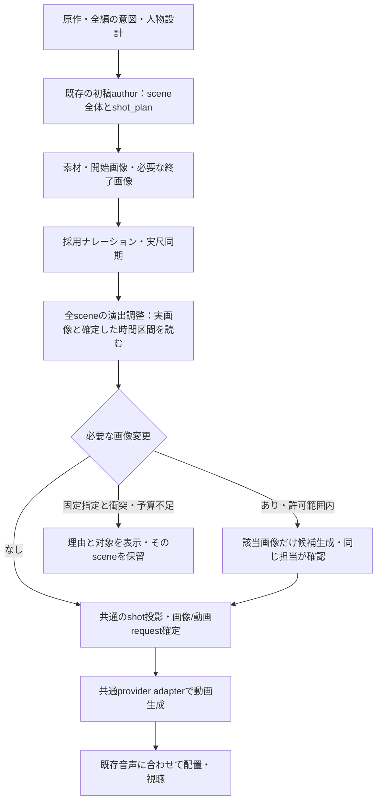

# 全シーンの演出を実音声・実画像に合わせる詳細設計

2026-10-13 / **ユーザーの実装指示を受けて実装へ移行**。実装・検証結果は implementation-validation.md を参照。以下は設計時の判断記録。赤ペンの確定事項は[decision.md](decision.md)。

## 1. 全体方針

初稿で撮り方を設計する既存経路を強化し、その後、画像と音声が確定した時点で同じ設計を実際の素材へ合わせる。作品の意図を判断するのは既存のauthorとし、別のcriticによる採点工程は追加しない。

新しいp-slotは作らない。接続点は、画像と採用音声の尺同期が揃った後、動画promptを確定してproviderへ送る前。全編の素材が揃うまで待つ実装でも、準備ができたsceneから順に進める実装でも、同じ入力条件とscene単位の責務を守る。最初の実装はscene順で実行し、前sceneの確定した引継ぎ状態を次へ渡す。

### 実際の接続点

現行の `scripts/toc-immersive-frontend-run.py` はp650/p680までで、画像・音声・動画を最後まで一つのrunnerで自動実行する入口ではない。既存の音声完了・採用操作から動画準備へつなぐoperationを設計し、画像生成runnerへ後段処理を押し込まない。

- 新規の「動画生成へ進む」実行操作は、全sceneの入力待ちを管理し、準備できたsceneを共通演出サービスへ渡す。設定した画像修正・動画生成の予算範囲をこの操作に束縛する。
- 演出調整と必要画像の生成が完了したら、既存の `/api/image-gen/video-prompts/create`（p830）へつなぐ。その後、既存の `/video-generate` または `/video-generate-bulk`（p840）へ進める。
- p830単独のpromptプレビュー/作成要求で、予期せず有料画像を生成しない。未準備なら不足と準備operationへの導線を返す。p840は準備結果の有効性を検証し、不足を黙って無視しない。
- 明示した単一cut修正は、そのsceneの文脈で対象cutだけを調整する。全scene自動調整という既定は新規制作に適用し、旧作品の閲覧や局所修正から全編の再生成へ広げない。

## 2. 初稿で判断させる内容

既存のp400/p420とSHOT_AUTHOR_GUIDANCEを正本にして、次を作品ごとに選ぶ。別の巨大な「演出回答票」は増やさない。

| 判断 | 保存先（既存） | 指示の要点 |
|---|---|---|
| このscene/cutで何を届けるか | scene_intent / purpose / shot_plan.intent | 理解、期待、驚き、距離感、余韻などから選ぶ。定型の感情曲線を強制しない |
| 何が見えれば伝わるか | initial_view / events / performance | 見える身体部分、対象、相手、契機を選ぶ。顔が見えないshotへ表情を要求しない |
| 行為と反応はどう続くか | motion / performance / end_state | 接触→力→結果など必要な因果と、見せるべき反応を観察可能な動きで記す |
| なぜ・いつ撮り方が変わるか | camera / events / initial_view.focus | 動作や注意の変化に結び付ける。各cutに一律の寄りや周回を追加しない |
| どこに時間を使うか | shots[].start_seconds / duration_seconds | 行為・理解・反応の時間を配分し、不要な移動を省く。足りなければshotを分ける |
| 何を画像で用意するか | initial_view / 任意のend_view / asset bindings | 次の動作が可能な静止状態にする。終了画像を毎回付けず、開始画をそのまま終端へ再利用しない |

カメラ用語の多さは目的ではない。例えば試着なら「足元で入らないことを見せ、靴を離した後に顔へ注意を移す」と行為と撮影を同じ時間軸で設計する。別の場面では手・背中・空間・静止を選べる。

## 3. 全シーンを対象とする仕上げのauthor入力

実行単位はscene。単独cutの改善だけで緩急が消えないよう、scene内の全cutと前後の境界を見る。

| 入力 | 扱い |
|---|---|
| 原作・storyと全編の演出方針 | 全編の意味と開示順を判断する根拠。局所cutから新しい事件を作らない |
| 対象sceneのscript・全cutのshot_plan | 原稿、意図、参加者、前後の動きをまとめて読む |
| 前後sceneの入口/出口、採用済みの人物・衣装・所持物 | 隣接シーンへ接続する状態。将来の出来事を先行して見せない |
| 採用音声と配置情報 | ファイルhash、実測尺、開始offset、明示した無音、親cutの有効区間。単語ごとの時刻は既にある場合だけ使用 |
| 採用画像 | shot IDと用途を明記した実画像をlocal_imagesとして添付。開始画、任意の終了画、必要な人物・状態参照を区別 |
| モデルの実行能力 | provider/model/mode、尺上限、参照方式、native audio方針。対応しない参照を黙って落とさない |
| ユーザーの固定条件と予算 | 音声・画像・演出の固定範囲、追加生成の許可回数/金額、使用済み枠 |

「実音声を考慮」は、採用ファイルと実測した時間配置を根拠にする意味。現在のテキスト/画像authorへ音声波形を渡して声の抑揚まで理解したとは主張しない。抑揚や語句単位の同期が必要な検証は、対応する音声解析を別途設計する。

下位のCodexAppServerClient.run_turnにはlocal_imagesがあるが、現行run_structured_story_turnとcut authorの呼出しにはそれが公開されていない。読み取り専用の構造化authorに任意の画像添付を通す拡張が必要。画像数が上限を超える場合、対象画像を黙って省略しない。scene全体の意図を保持したまま、shot画像を安定IDで分割して読み、最終的な設計をscene担当が所有する。

## 4. 出力と変更の範囲

正式な演出データは引き続き親cutのshot_plan。処理の結果は次の3種類とする（名称は提案であり現行schemaではない）。

- unchanged: 入力を確認し、演出・画像の変更は不要。既存requestと素材を保持。
- revised: 変更したcutのshot_plan、必要な画像の修正指示、変更理由と影響範囲。
- needs_input: 固定条件の衝突、予算未設定/超過、必須行為と尺の不整合など。対象と選択可能な解決策を示す。

保存するのは短い演出理由と決定、実入力の参照/ハッシュ、差分。内部思考の逐語記録は要求しない。scene担当は必要なcutだけ変更し、cut数・順序・原作契約・採用音声は変更しない。cut内のshot数や画角の変更は許容する。

現在のcut editorが持つvisual-only投影とshot_direction_overrideを共有する。共有するのは投影・不変条件の検証であり、run全体revisionを要求する既存の保存関数をそのままscene単位保存に転用しない。scene内の複数cutについて、すべて検証してから一括公開する。生成途中のcandidateは一時領域へ保存し、正式manifestに不完全なshot列を公開しない。旧cinematic_direction.jsonを別途書き換えて二重管理しない。

## 5. 画像修正の実行

1. どの画像の何が行為を妨げるか、既存の開始状態と演出意図から説明する。例：踵まで入っている画像では「入らない」を始めにくい。
2. 固定画像、人物identity、変身前後の状態、実際にAPIへ渡せる参照を確認する。
3. 必要なshot画像だけを既存の画像生成経路で新候補として作る。新shotが増える場合はその開始画像も対象。終了画像の追加は別途必要性を判断する。
4. 同じ担当が生成した実画像を読み、狙った開始状態・同一性・意図しない差を確認する。独立criticや点数による常設gateにはしない。
5. 不成立なら理由を返し、そのsceneは動画APIへ送らない。合格まで自動再生成するループは初期実装に含めない。

回数方針案：同じ入力revisionに対するscene全体の演出調整は1回。変更画像は各shot・用途につき追加生成1回までを初期上限とする。生成後の確認は画像の確認だけで、scene全体の再演出を始めない。形式エラーの修復やtransport再開は既存の有限回復契約に従い、上限消費と別に記録する。ユーザーが追加修正を依頼した場合は、新しい指示revisionとして明示的に扱う。

金額/回数上限は実行設定で明示する。既存のProductionRepairLedgerは試行回数の記録であり、金額上限を保証する仕組みとは扱わない。追加画像数が許可回数内でも、金額枠が足りなければ送らない。画像分岐だけでなく、shot増加による動画request数・切上げ生成尺も追加費用へ含める。価格が取得できない場合は金額を捏造せず、見積不能として扱う。今回は上限額を設定しない。

## 6. 尺・音声・参照の不変条件

- 親区間の長さは既存のparent_duration_secondsを用いる。音声durationだけに置き換えず、採用したoffsetと明示的な間も保持する。
- child shotは0秒から隙間/重なりなく並び、合計が親区間と一致する。既存shot_timelineの検証・編集時trimを使う。
- 現行の音声尺同期は親video/render尺を変更するが、shot_planを自動再配分しない。今回のサービスでその不一致を解消する。音声が伸びたとき、古いshotへ秒数を比例配分するだけで演出の調整を済ませない。動作・反応の時間を再判断する。
- 新しい視覚設計でも音声は親cutへ一度だけ配置する。音声bytes、採用voice、字幕やナレーション区間を勝手に作り直さない。
- 再利用する画像も実ファイルのhashと新しいrequestとの適合を記録する。昔の生成履歴を新promptで生成した履歴として上書きしない。
- 同一性参照のない人物を後半に出す計画は、適切な開始画像を持つshotへの分割など、実行可能な参照経路へ直す。

## 7. 同時編集・再開・状態

入力snapshotは、原作/演出方針、対象sceneと境界状態、採用音声と配置、実画像bytes、素材参照、ユーザー指示、モデル能力、author方針版を束縛する。予算の消費・予約は別の永続台帳で管理し、意味内容のキャッシュと混同しない。

authorの実行中は長い書込lockを保持しない。commit時にrun lockの下で入力revisionを再照合する。他スレッドが採用画像や音声を変更していたら、旧snapshotの結果を正式採用しない。無関係なsceneが変更された場合は、新サービスのcommit処理が最新manifestを再読込し、対象scene・参照画像・境界状態等の依存値が一致することを検証した後、許可された視覚差分だけを適用する。既存cut editorのrun全体revisionチェックを緩める実装にはしない。依存関係を確実に限定できなければ競合として返す。

必要な運用状態案は「入力待ち／演出調整中／画像修正中／動画生成可能／ユーザー判断待ち／失敗」。既存のoperation保存・append-only stateへscene単位で投影する。schemaへは実装時に追加し、新p-slotは作らない。全sceneの準備完了と1sceneの完了を区別する。

現行MediaJournalはrun全体のmanifest hashを束縛するため、どこかのmanifestが変われば同じoperationの再開を拒否する。この保護を外さない。入力不変なら既存journalで再開し、入力変更後は新しい準備operationを作る。完了済みshotの再利用は、旧operationを改変せず、個別request・参照・出力bytesの一致を再検証したうえで、新operationに元の生成履歴へのリンクを記録する。依存関係を絞れない成果は再利用しない。scene単位の準備snapshotと、新operationへの安全な候補取込は追加実装が必要。

送信再開はproviderごとの確認が必要。Higgsfieldの専用journalと、完了までtask IDを永続化しない他のKling/Seedance経路を同等に扱わない。対象adapterでは、送信前intent→受理したrequest IDの即時永続化→poll→出力保存を実装・検証する。request IDがあれば照会し、受理の有無が不明かつIDも得られなければunknownとして停止し、同じPOSTを自動再送しない。費用予約も不明なまま解放しない。画像差替えは依存するshotのrequestと合成結果だけを古い状態にし、採用済みの音声・他sceneは保持する。全編の最終結合は既存の動画採用・BGM/SE設定確定の条件を保つ。

## 8. フロント・CLI・会話の接続

| 箇所 | 設計する差分 |
|---|---|
| toc/p400_authoring.py / toc/shot_direction.py | 初稿の意図・演技・撮影・時間の判断文を整理。既存の判断欄とschemaを再利用 |
| toc/story_author_runtime.py / server/codex_app_server.py | 読み取り専用の構造化authorへ、検証済みlocal_imagesを渡す。入力hash/中断・timeoutの回収も保持 |
| 共通演出サービス（新設候補 toc/scene_direction_service.py） | scene入力snapshot、author呼出し、差分計画、予算判定、画像修正、再開の調整。パス名は実装着手時に確定 |
| server/cut_direction_api.py / toc/shot_projection.py | 既存visual-only適用をサービスへ共有化。scene単位の複数cut検証とatomic commitを追加。CLIからserverの私有関数を直接使わない構成へ |
| 動画materialization/実行入口・対象provider adapter | 有効な演出結果と必要画像が揃ってからrequestを確定。古いsnapshotのままAPI送信しない。受理IDをpoll開始前に永続化する |
| server/web/src/CutDirectionPanel.tsx | 既存の前後cut一覧へ状態・短い変更理由・対象画像・時間配分・追加費用を表示。毎cutの承認を追加しない |
| scripts/edit-cut-direction.py / generation skills | 手動修正も同サービス経由にする。通常生成と修正で別の真実を持たない |

表示内容の例：「試着後の反応に4秒を確保」「開始画像の踵の位置を修正」「音声は変更なし」。APIの内部IDやハッシュは詳細欄へ置き、通常表示では意図と影響を説明する。画像固定と予算超過などユーザー判断が必要な箇所だけ操作を求める。画面の具体的配置は、実装前に現行コンポーネントの表示に沿って作る。

## 9. 検証計画：別の物語を1本通す

実装後、ユーザーが選んだ別の物語を、新規runとして初稿から制作する。このチャットで作ったシンデレラ専用の修正promptを入力せず、フロントの通常経路で全sceneを処理する。動作、反応、静かな場面、場面間の接続が自然に含まれる作品を選び、検証の都合で原作へ事件を足さない。

### 有料生成前に機械で確認する項目

- 全sceneの処理対象記録。変更不要のsceneも理由と参照入力が残る。
- 実画像の添付、音声実尺/offset/無音の束縛、親cutとshotの尺一致。
- 画像・動画promptに設計した行為・反応・カメラが欠落せず、表示と実payloadが同じsnapshotから出る。
- 同一性/状態参照の到達、optional終端、固定素材の保護、予算上限、停止と再開。
- フロント・CLI・会話が同じ保存済みplanから同じrequestを構築する。

### 実映像で確認する項目

- 必要な行為が映像として実行され、観客が何が起きたか理解できるか。
- 意図した反応が、見える身体と時間の中で読めるか。顔や感情変化を全sceneへ強制しない。
- カメラの動き/静止と編集が注目先を助け、全編に緩急があるか。
- 人物・衣装・道具・変身前後の姿とナレーションが一貫し、場面間がつながるか。

初回の全編結果を保存して提示する。追加の会話修正が必要になった箇所は、初稿の結果と混ぜずに原因を記録する。自動制作の質を測るため、修正した最終版だけを「一発でできた」と扱わない。合格は作品の視聴で判断し、構造テストの成功や自動スコアで代替しない。

有料実行前に決める項目は、作品と原資料、映像/音声モデル、総額・追加生成回数の上限、出力仕様、BGM/SEの有無。金額と成功率の数値は現時点では未見積もり。

## 10. 実装順

1. 共通入力snapshotと画像添付、実尺・不変条件の回帰テスト。
2. 既存のshot author/適用を共通化し、scene単位の差分公開と再開を実装。
3. 画像修正候補・予算制御・request確定前の接続を実装。
4. フロント/CLI/会話の接続と、既存一覧の状態・差分表示。
5. 無課金fixtureで全編経路を検証後、許可された別の物語1本を制作・視聴する。

この順序は実装を開始する指示ではない。今回の完了点は、判断済み方針を作業可能な設計と未着手タスクへ残すこと。
